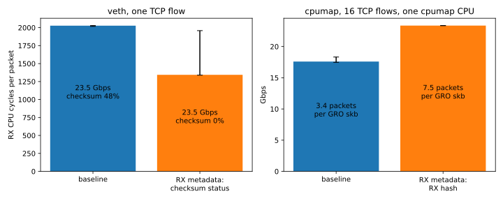

# skb core extensions benchmarks

Measurements for the series "[PATCH bpf-next 00/15] xdp: add SKB core extensions to keep RX metadata until skb
creation". With the series, an XDP program can store the RX hash, the VLAN tag and the checksum status. The skb that
the kernel builds after an XDP_REDIRECT to veth or cpumap then carries them.

| Measurement | Question | Test | Results |
|---|---|---|---|
| veth, checksum status | How much of the RX CPU goes to software checksum verification, with and without a stored checksum status? | veth-tcp | `results/veth-checksum/` |
| cpumap, RX hash | Does a stored RX hash change the throughput and the GRO batch size? | cpumap-tcp-16 | `results/cpumap-rx-hash/` |

Summary, median of 5 rounds (`report.py` prints this table):

| test | metric | baseline | RX metadata |
|---|---|---|---|
| veth, 1 TCP flow | RX CPU busy | 100% | 66% (-34%) |
| veth, 1 TCP flow | RX cycles/pkt | 2027 | 1343 (-34%) |
| veth, 1 TCP flow | throughput | 23.5 Gbit/s | 23.5 Gbit/s (+0%) |
| cpumap, 16 TCP flows | throughput | 17.6 Gbit/s | 23.4 Gbit/s (+33%) |
| cpumap, 16 TCP flows | pkts/GRO skb | 3.4 | 7.5 (+122%) |

- Both veth columns reach line rate, so the gain is in CPU time.
- A store kfunc takes 2.9 ns per packet (veth, checksum status) to 4.9 ns (cpumap, VLAN tag and RX hash).

Both tests ran on two bare-metal hosts at 25 Gbit/s through one switch. The receiver has an AMD EPYC 9755 (128 cores,
SMT on, 16 NUMA nodes) and an Intel E810-XXV (ice). It runs the kernel under test. The sender only generates traffic.

| Kernel | Tree |
|---|---|
| bpf-next 0fb18ce8a2e9 + the series (15 patches, tip 4efd1d53595f) + patches 1-3 of [Lorenzo Bianconi's RX checksum kfunc series v5](https://lore.kernel.org/all/20260715-bpf-xdp-meta-rxcksum-v5-0-623d5c0d0ab7@kernel.org/) | source tree 8dc0da01f4e8 |

- Lorenzo's patches 1-3 add `bpf_xdp_metadata_rx_checksum()`, which the veth program uses to read the NIC's checksum
  status. His copy of `enum xdp_checksum` is dropped, because the series defines the same enum.
- The series tip 2b387331f289 differs from 4efd1d53595f only in commit messages and 5 comment lines.

## veth, checksum status

### Setup

```
sender --25G-- NIC (ice, xdp_veth: XDP_REDIRECT) -> veth0 --veth-- veth1 (GRO on) -> netserver in netns svc
```

- Two variants, same kernel, same XDP object:
  - baseline: `xdp_veth` redirects the packet into veth0.
  - RX metadata: `xdp_veth` reads the checksum status with `bpf_xdp_metadata_rx_checksum()`, stores it, then redirects.
- Traffic: one TCP flow, `netperf -t TCP_STREAM` from the sender.
- veth1 gets the MAC address of the NIC and the receiver's address (/32). So the sender talks to the receiver's normal
  address, and XDP on the NIC redirects the packets into veth0.
- The pair has a link network 10.0.2.0/24. The default route in svc goes through veth0, with the receiver's address as
  the source. The host forwards the replies out of the NIC. veth0 has `accept_local=1`, `rp_filter=0` and forwarding
  on, because the replies come in with a local source address.
- GRO on veth1 turns on NAPI on veth1, which veth needs to take XDP frames. IPv6 is off on the pair.
- One RX queue: `ethtool -X <nic> equal 1` sends all flows to queue 0, with its IRQ on CPU 98. XDP, the NIC's NAPI,
  veth NAPI, GRO and TCP run on CPU 98. netserver runs on CPU 102. Both CPUs are on the NIC's NUMA node.
- Each XDP program acts only on IPv4 packets from the sender's address, and passes all other packets. The test traffic
  and the rest of the host traffic share the hosts' normal addresses on a VLAN.

Each test runs 5 rounds, and the variants alternate within each round. Before each round, the receiver renews the DHCP
lease of its address, so no renewal falls into a round. Each round runs the client for 20 s. After 5 s, the receiver
samples for 10 s:

- **Busy**: MPERF/TSC of the CPU, from `perf stat` on the msr PMU.
- **Cycles per packet**: APERF of the CPU over the packets the XDP program counted. The XDP counters, the NIC counters
  and `nstat` are read before and after the sample, each with a timestamp.
- **Function cost per packet**: the function's share of the CPU's samples in `perf record -F 4999`, times the CPU's
  cycles per packet. Store kfuncs are `bpf_xdp_skb_ext_store_*()` and `xdp_skb_ext_add()`. Setting the skb fields is
  `xdp_skb_ext_to_skb()`.
- **Software checksum**: the share of `csum_partial()`, `do_csum()`, `__skb_gro_checksum_complete()`,
  `__skb_checksum_complete()`, `__skb_checksum()` and `csum_partial_copy_generic()`.

### Results

Median of 5 rounds, minimum and maximum in brackets:

| | Baseline | RX metadata |
|---|---|---|
| Throughput, Gbit/s | 23.47 [23.44, 23.47] | 23.47 [23.46, 23.47] |
| RX CPU busy | 99.56% [99.11, 99.63] | 65.98% [65.79, 96.16] |
| RX CPU cycles per packet | 2027 [2018, 2029] | 1343 [1339, 1958] |
| Software checksum, share of RX CPU | 47.94% [47.64, 48.22] | 0% |
| Store kfunc, ns per packet | | 2.895 [2.702, 3.189] |
| Setting the skb fields, ns per packet | | 1.434 [1.301, 1.497] |

- **Throughput**: the link limits both variants to 23.5 Gbit/s, so the gain shows as RX CPU time.
- **Checksum**: with the stored status, GRO on veth1 does not verify the checksum in software. The RX CPU needs 34%
  fewer cycles per packet.
- **Noise**: one RX metadata round has the RX CPU at 96% busy and 1958 cycles per packet. The other four are at 66% and
  1339 to 1345. The median is not affected.
- **Errors**: in every round of both tests, the NIC's `rx_csum_bad`, TcpInCsumErrors, UdpInCsumErrors and the XDP
  program's store errors are 0.

## cpumap, RX hash

### Setup

```
sender --25G-- NIC (ice, xdp_cpumap: XDP_REDIRECT) -> cpumap kthread on CPU 100 (skb, GRO, TCP) -> iperf3 server
```

- Two variants, same kernel, same XDP object:
  - baseline: `xdp_cpumap` stores the VLAN tag, then redirects to cpumap.
  - RX metadata: `xdp_cpumap` also reads the RX hash with `bpf_xdp_metadata_rx_hash()` and stores it.
- Both variants store the VLAN tag. ice strips the tag into the RX descriptor. Without it, the skb would arrive on the
  physical device and not on the VLAN device that holds the receiver's address.
- Traffic: 16 TCP flows, `iperf3 -P 16` from the sender. The iperf3 server runs on the host, on CPU 102.
- One RX queue as in the veth test. XDP runs on CPU 98. The cpumap kthread on CPU 100 builds the skbs and runs GRO and
  TCP.
- Rounds and counters as in the veth test. **Packets per GRO skb**: the packets the XDP program counted over
  IpInDelivers.

### Results

Median of 5 rounds, minimum and maximum in brackets:

| | Baseline | RX metadata |
|---|---|---|
| Throughput, Gbit/s | 17.6 [17.47, 18.32] | 23.36 [23.35, 23.36] |
| Packets per GRO skb | 3.372 [3.309, 3.623] | 7.496 [7.376, 7.529] |
| cpumap CPU busy | 100% | 100% |
| RX CPU busy | 21.32% [21.01, 22.38] | 38.3% [37.66, 38.61] |
| Store kfuncs, ns per packet | 2.01 [1.927, 2.236] | 4.936 [3.903, 5.522] |
| Setting the skb fields, ns per packet | 1.127 [0.8716, 1.234] | 1.306 [1.093, 1.581] |

- **GRO**: without a stored hash, every skb that cpumap builds has hash 0, so all 16 flows go into the same GRO bucket.
  With the hash, GRO merges more than twice as many packets per skb.
- **Throughput**: the cpumap CPU is at 100% in both variants. With the hash, it forwards 33% more.
- **Store cost**: the store cost without the hash is the VLAN store.
- **RX CPU**: it spends about 210 more cycles per packet with the hash stored (574 against 783). The profile puts only 12
  of them in the store kfuncs (8.3 against 20.4). The cpumap CPU limits the throughput, not the RX CPU.
- **Noise**: the baseline throughput varies from 17.47 to 18.32 Gbit/s. The ranges do not overlap.

## Run

On the receiver, in tmux, with netperf, iperf3 and perf installed. The sender needs passwordless ssh from root on the
receiver, iperf3 and netperf. Requirements: two x86 hosts on one link, an ice NIC on the receiver, Debian 13 (the build
uses its kernel config). The addresses, interfaces and CPUs are variables at the top of `bench.sh`.

```
./bench.sh build <series-patch-dir>                         # then reboot into 7.4.0-rc1-skbext-v1-rxcsum+
sudo ./bench.sh run results 2>&1 | tee run.log              # veth-checksum/, cpumap-rx-hash/
uv run --with matplotlib python3 report.py results          # tables, results/bench.svg
```

- `build` applies the series and Lorenzo's patches to the base commit, prints the source tree hash, builds and installs
  the kernel. It also builds selftests/bpf, which gives the bpftool that `bench.sh` uses.
- Each test first sets the governor and boost, stops irqbalance, sets the rings and adaptive coalescing, and stops with
  an error if an offload is off. It changes a setting only if it differs, because a ring change resets the link.
- `record_state` writes `state.txt`. When a test exits, it restores the RSS table and removes the XDP program and the
  veth pair.



## Files

| File | Content |
|---|---|
| `bench.sh` | `build`: the kernel. `run`: both tests. `test`: host settings and one test |
| `bench.bpf.c` | The XDP programs |
| `report.py` | Tables and `results/bench.svg` from the raw files |
| `lorenzo-rx-checksum-v5-1-3.patch` | Lorenzo's RX checksum patches 1-3, rebased onto the series |
| `results/<measurement>/` | `state.txt` (kernel, CPUs, NIC settings), and one directory per test. Per round: `store<0\|1>-r<round>` with `.client` (client output), `.counters`, `.msr` (cycle counts) and `.perf.txt` (profile). store0 is baseline, store1 is RX metadata |

## Settings

Receiver. The first rows come from `state.txt` in the results directories. Pause frames, RPS, ntuple, the other
offloads, sysctls and MTU were read on the same host after the runs.

| Item | Setting | Set by |
|---|---|---|
| Kernel | 7.4.0-rc1-skbext-v1-rxcsum+ | `bench.sh build` |
| Kernel config | Debian 13 config (linux-image-6.12.111+deb13-amd64) plus the net, drivers/net/hw and bpf selftest fragments, `DEBUG_INFO_BTF_MODULES=y`, `VETH=m`, no signing keys | `bench.sh build` |
| Cmdline | `iommu=pt cgroup.memory=nosocket`, plus console and panic options. No `mitigations=`, so the mitigations are the kernel defaults | boot loader |
| Governor, boost | performance, boost on | `bench.sh test` |
| Idle states | POLL, C1 and C2, all enabled | kernel default |
| SMT, irqbalance | on, not running | `bench.sh test` stops irqbalance |
| CPUs | NUMA node 12 of the NIC: RX CPU 98, cpumap CPU 100, application CPU 102 (`taskset`). No `isolcpus`, no `nohz_full` | `bench.sh` |
| NIC channels | 256 combined. The RSS table sends all flows to queue 0, with its IRQ on CPU 98 | `bench.sh` |
| Rings, coalescing | RX 2048, TX 256, adaptive RX and TX, `rx-usecs` 50 (driver defaults) | `bench.sh test` |
| Pause frames | RX off, TX off | default |
| Offloads | GRO, RX checksum, RX hash and RX VLAN on. LRO off, HW GRO off, rx-udp-gro-forwarding off | `bench.sh test` stops if one of the first four is off |
| RPS, ntuple | off, no rules | default |
| XDP | the program of the test, in driver mode on the NIC | `bench.sh` |
| Sysctls | defaults (fq_codel, `netdev_max_backlog` 1000, cubic), `ip_forward` 0. veth0: `accept_local` 1, `rp_filter` 0, forwarding 1 | `bench.sh` for veth0 |
| MTU | 1600 on the NIC and the VLAN device. The test packets are at most 1500 bytes | host config |
